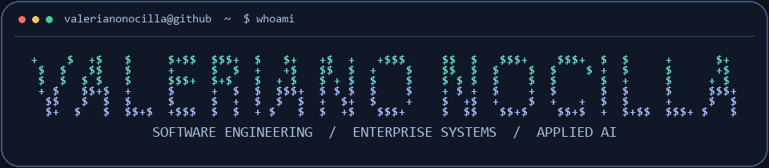
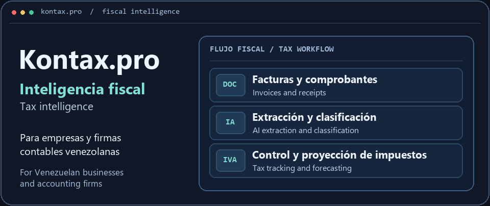
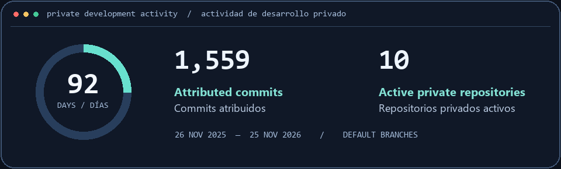

  

  

  <strong>Web &amp; Mobile · ERP / MRP / MES · BI &amp; Data Mining · AI Agents</strong> 
  Web y móvil · ERP / MRP / MES · BI y minería de datos · Agentes de IA

  <a href="#english">English</a> · <a href="#español">Español</a> · <a href="#kontaxpro">Kontax.pro</a> · <a href="#technology-stack--tecnologías">Stack</a> · <a href="#github-activity--actividad-en-github">GitHub Activity</a>

  
  
  

---

## English

**Professional profile**

I develop web and mobile applications, enterprise systems, and applied AI solutions. My work connects business requirements with software delivery, from application architecture and data modeling to integrations, workflow automation, and operational reporting.

---

## Español

**Perfil profesional**

Desarrollo aplicaciones web y móviles, sistemas empresariales y soluciones de IA aplicada. Traduzco los requisitos del negocio en software, desde la arquitectura de aplicaciones y el modelado de datos hasta las integraciones, la automatización de flujos y los informes operativos.

---

## Kontax.pro

**EN** · I work on Kontax.pro, where AI-assisted document processing feeds accounting workflows, financial dashboards, and tax reporting across multiple companies.

**ES** · Trabajo en Kontax.pro, donde el procesamiento de documentos con IA alimenta los flujos contables, los tableros financieros y los reportes fiscales de varias empresas.

[Visit Kontax.pro / Visitar Kontax.pro](https://www.kontax.pro/)

---

## Technology stack / Tecnologías

  

**Languages / Lenguajes**

   

**Web & mobile / Web y móvil**

   

**Databases & data / Bases de datos y datos**

   

**Integration & infrastructure / Integración e infraestructura**

    

---

## GitHub activity / Actividad en GitHub

**EN** · GitHub API snapshot for Nov 26, 2025 through Nov 25, 2026 at noon (UTC−4). The ring shows **92 of 365 days** with attributed commits. Counts use unique commits linked to this account on the default branches of accessible private repositories.

**ES** · Datos de la API de GitHub del 26 nov 2025 al 25 nov 2026 al mediodía (UTC−4). El círculo muestra **92 de 365 días** con commits atribuidos. Se cuentan commits únicos vinculados a esta cuenta en las ramas predeterminadas de los repositorios privados accesibles.

[Public contribution calendar / Calendario público de contribuciones](https://github.com/valerianonocilla#js-contribution-activity)

---

## Blockchain / Web3

Blockchain experience / Experiencia en blockchain

**EN** — Specialist blockchain and Web3 development across Ethereum, BNB Smart Chain, Polygon, and Solana. Expertise spans smart contracts, decentralized applications, Web3 integrations, RPC node infrastructure, on-chain monitoring, front-running programs, and MEV bots.

**ES** — Desarrollo especializado en blockchain y Web3 en Ethereum, BNB Smart Chain, Polygon y Solana. Experiencia en contratos inteligentes, aplicaciones descentralizadas, integraciones Web3, infraestructura de nodos RPC, monitoreo en cadena, programas de front-running y bots MEV.

**Tools / Herramientas** — Solidity, Rust, Hardhat, Foundry, Anchor, web3.js, ethers.js.

**Public repository / Repositorio público** — [Solana Vanity Wallet Generator](https://github.com/valerianonocilla/Solana-Vanity-Wallet-Generator).

---

  

