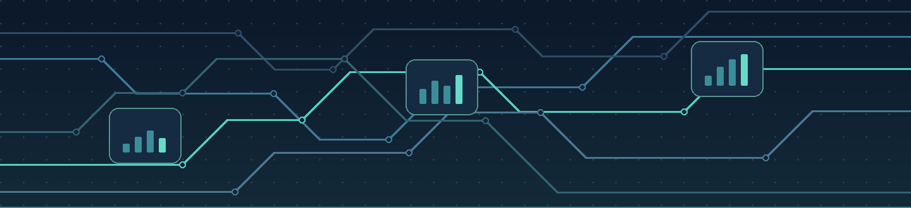

  

<h1 align="center">Valeriano Nocilla</h1>

<strong>Web Development · Custom ERP, MRP &amp; MES · Business Intelligence</strong> Desarrollo web · ERP a medida, MRP y MES · Inteligencia de negocios

<a href="#english">English</a> · <a href="#español">Español</a> · <a href="#technology-stack--tecnologías">Stack</a> · <a href="#github-activity--actividad-en-github">Activity / Actividad</a>

---

## English

I build web applications and enterprise systems that connect sales, finance, inventory, manufacturing, and reporting. My work covers application development, integrations, data migration, and the reports teams use to run their operations.

| Focus | What I build |
| --- | --- |
| **Professional web development** | Customer portals, internal applications, e-commerce, and billing tools. Responsive interfaces, role-based access, and API integrations. |
| **Custom ERP and business solutions** | Workflows for sales, purchasing, inventory, accounting, billing, payroll, and HR. Business rules, approvals, and integrations tailored to each operation. |
| **MRP and MES** | Bills of materials, material requirements, production orders, and inventory availability. Shop-floor execution, work-in-progress tracking, and production traceability. |
| **Business intelligence and data mining** | Data extraction, cleaning, and reconciliation. SQL reporting, KPI dashboards, and analysis to identify patterns and investigate operational discrepancies. |
| **Data and systems integration** | Migration from legacy systems, data mapping, and validation of imported records. API and file-based exchanges between operational and financial systems. |

---

## Español

Desarrollo aplicaciones web y sistemas empresariales que conectan ventas, finanzas, inventario, producción y reportería. Mi trabajo abarca el desarrollo de aplicaciones, las integraciones, la migración de datos y los informes que los equipos usan para gestionar su operación.

| Área | Qué desarrollo |
| --- | --- |
| **Desarrollo web profesional** | Portales de clientes, aplicaciones internas, comercio electrónico y herramientas de facturación. Interfaces adaptables, acceso por roles e integraciones mediante API. |
| **ERP a medida y soluciones empresariales** | Flujos de ventas, compras, inventario, contabilidad, facturación, nómina y recursos humanos. Reglas de negocio, aprobaciones e integraciones adaptadas a cada operación. |
| **MRP y MES** | Listas de materiales, cálculo de necesidades, órdenes de producción y disponibilidad de inventario. Ejecución en planta, seguimiento de órdenes en curso y trazabilidad de la producción. |
| **Inteligencia de negocios y minería de datos** | Extracción, limpieza y conciliación de datos. Reportes SQL, tableros de indicadores y análisis para detectar patrones e investigar discrepancias operativas. |
| **Integración de sistemas y datos** | Migración desde sistemas heredados, mapeo de datos y validación de registros importados. Intercambio por API y archivos entre sistemas operativos y financieros. |

---

## Technology stack / Tecnologías

**Languages / Lenguajes**

   

**Web & mobile / Web y móvil**

   

**Databases & data / Bases de datos y datos**

   

**Integration & infrastructure / Integración e infraestructura**

    

---

## Featured project / Proyecto destacado

> **[Venezuelan localization for Odoo / Localización venezolana para Odoo](https://github.com/valerianonocilla/l10n-venezuela-bw)**
>
> Public ERP repository for Venezuelan fiscal and payroll localization, including VAT, tax withholding, fiscal books, and point-of-sale requirements.
>
> Repositorio público de localización fiscal y de nómina para Venezuela. Incluye IVA, retenciones, libros fiscales y requisitos de punto de venta.

---

## GitHub activity / Actividad en GitHub

  <a href="https://github.com/valerianonocilla#js-contribution-activity">
    <picture>
      <source media="(prefers-color-scheme: dark)" srcset="https://streak-stats.demolab.com/?user=valerianonocilla&amp;theme=github-dark-blue&amp;ring=5EEAD4&amp;fire=5EEAD4">
      
    </picture>
  </a>

The ring shows the current streak in days. The card tracks contributions visible on GitHub, including eligible commits, issues, pull requests, and reviews.

El círculo muestra la racha actual en días. La tarjeta cuenta las contribuciones visibles en GitHub, incluidos commits, incidencias, pull requests y revisiones que cumplen los criterios de la plataforma.

[Contribution calendar / Calendario de contribuciones](https://github.com/valerianonocilla#js-contribution-activity)

---

## Blockchain / Web3

Blockchain experience / Experiencia en blockchain

Independent projects involving smart contracts, RPC node infrastructure, and on-chain automation across Ethereum, BNB Smart Chain, Polygon, and Solana.

Proyectos independientes de contratos inteligentes, infraestructura de nodos RPC y automatización en cadena en Ethereum, BNB Smart Chain, Polygon y Solana.

**Tools / Herramientas** — Solidity, Rust, Hardhat, Foundry, Anchor, web3.js, ethers.js.

**Public repository / Repositorio público** — [Solana Vanity Wallet Generator](https://github.com/valerianonocilla/Solana-Vanity-Wallet-Generator).

